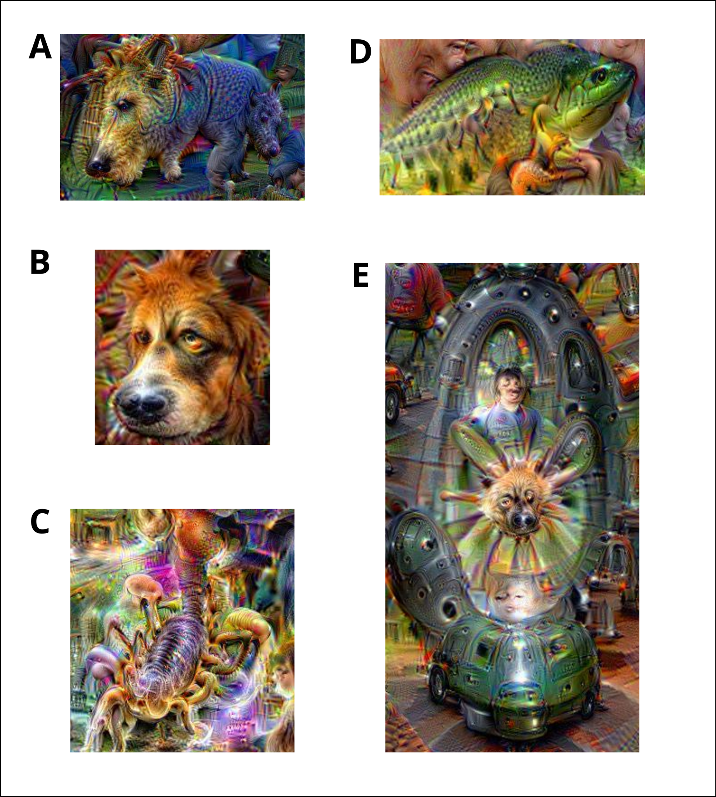

# The Human–Machine Interface: From Tool Use to Philosophical Contemplation

*A collection of six reflections on scientific expertise, artificial intelligence, technical exploration, creativity, perception, and the limits of language models.*

## Contents

1. [Artificial Intelligence and Frogs](#1-artificial-intelligence-and-frogs)
2. [Art or Science? An Age-Old Question Revisited by AI](#2-art-or-science-an-age-old-question-revisited-by-ai)
3. [Diving into the Depths of Dreams — Part 1: Before Diving In, You Need a Vessel](#3-diving-into-the-depths-of-dreams--part-13)
4. [Diving into the Depths of Dreams — Part 2: The Symbols of Connectionism](#4-diving-into-the-depths-of-dreams--part-23)
5. [Diving into the Depths of Dreams — Part 3: Does Attention Create Form, or Does Form Capture Attention?](#5-diving-into-the-depths-of-dreams--part-33)
6. [The Context Window: The Hidden Parameter You Shouldn't Overlook](#6-the-context-window-the-hidden-parameter-you-shouldnt-overlook)

---

## 1. Artificial Intelligence and Frogs

**Can algorithms do without human expertise?** In an age when artificial intelligence is dramatically expanding the capabilities of automation and machine learning, where does that leave us humans? This is a thorny question that has become increasingly pressing, and one I would like to explore through the lens of research in comparative genomics.

During my Master's degree in bioinformatics, I contributed to a research project aimed at clustering 938,864 viral protein sequences and functionally annotating the resulting clusters. The goal was to build a reliable database for the annotation of viral metagenomes. This work was published in the peer-reviewed journal *NAR Genomics and Bioinformatics* ([publication](https://lnkd.in/dSjk9tS5)).

Briefly, all protein sequences were compared against one another, and those exhibiting sufficiently significant local alignments were connected to form pairs. From the resulting graph, an initial clustering was performed using MCL (Markov Clustering Algorithm). For each cluster, a multiple sequence alignment was then used to build a corresponding Hidden Markov Model (HMM) profile. These profiles enabled a second round of clustering to identify more distant evolutionary relationships. The resulting secondary clusters, known as PHROGs (Prokaryotic Virus Remote Homologous Groups), were functionally annotated through a combination of specialized databases and manual expert curation.

**What was the key factor behind the widespread adoption and citation of PHROGs by the scientific community?** I believe it was the exceptional quality of their annotations, made possible by the expertise of researchers who had devoted their careers to studying these viruses. It was this *manual curation* that gave meaning and value to the tremendous computational power of the algorithms.

Admittedly, the clustering strategy described here does not involve artificial intelligence in the sense we commonly understand it today (although the parameters of the HMM profiles are indeed learned from the clustered sequences). Yet I believe the underlying principle remains the same. If artificial intelligence is a tool, then by definition, it should serve our purposes. We are therefore responsible for setting its intentions and guiding its direction. It is still the same dialogue between human vision and the power of technology, except that with AI, the frequency of interaction increases and the nature of expertise shifts.

The aptly chosen name *PHROGs* reminds me of the famous boiling frog fable. Artificial intelligence is turning up the heat so abruptly that the sleeping frogs are jumping out of the pot. **AI confronts humanity with a fundamental question of meaning and purpose.** It compels us to collectively redefine ourselves, and to me, that is the most fascinating aspect of this technological revolution.

---

## 2. Art or Science? An Age-Old Question Revisited by AI

This week, I was experimenting with a new AI-powered tool for scientific literature research: Elicit. Designed to facilitate literature searches and the synthesis of scientific publications, this tool left me genuinely impressed. I must admit that the PhD student I once was, back when AI was not yet widely accessible to the public, would have been absolutely blown away by its efficiency. One prompt, a few minutes of waiting, and there it was: a comprehensive, fully referenced literature synthesis report, almost a review article in itself. Back then, achieving a similar result would have taken weeks of work... Naturally, this made me question, once again, the role of researchers in the age of deep learning and generative AI.

These technologies demonstrate just how far machines can surpass us when it comes to organizing existing knowledge and uncovering connections between previously generated data. Yet there seems to be a fundamental boundary: the frontier of current knowledge itself. In other words, while today's models can generate novel predictions and unexpected combinations of ideas, they ultimately rely on patterns learned from existing information. But does this really mean they cannot think *outside the box*?

This question brings us directly to the nature of intuition itself, a topic that could easily inspire several other deep dives. For the sake of this reflection, I would like to make an assumption: **what if there exists a form of knowledge that cannot be fully explained through language or formal logic, something inherently deeper than what could emerge from simply connecting existing ideas across disciplines?** Let us adopt this as our working hypothesis and call it *intuition*.

Following this hypothesis, intuition cannot be entirely separated from the physical nature of the being experiencing it. In our case, that means the human body. We cannot rule out the possibility that artificial intelligence might develop its own form of intuition. However, even if it did, there is no reason to assume it would be identical to ours. Human consciousness has emerged through millions of years of biological evolution, deeply intertwined with our bodies, sensory experiences, and interactions with the world. Current AI systems do not share that evolutionary and embodied history.

Perhaps, then, what remains distinctively human is not intuition itself, but **our particular way of experiencing it**: that peculiar state of awareness that can precede both great scientific discoveries and remarkable works of art.

This question resonates deeply with me, both as a researcher and as a musician. From my perspective, art and science have much more in common than we might think. Both begin with a creative intuition. Then comes the demanding work of shaping a medium of expression or inquiry: for science, that medium is the physical world; for art, it is emotion. Finally, the creative process reaches its full expression when it becomes an interaction with the wider world: the publication of a scientific paper, a conference, a concert, an album, and so on.

To me, the main difference therefore lies in the material being explored. But when it comes to their starting point and ultimate destination, both paths converge.

**It is that dizzying moment of awareness at the heart of our existential experience, the boundary between what we can understand and what lies beyond our comprehension.**

It is along this edge of consciousness that intuition emerges, and it is also where the journey of creation eventually brings us back.

Ultimately, I feel that both art and science help humanity question and define itself. And this journey, it seems to me, is something no tool, however powerful, can undertake on our behalf.

---
## 3. Diving into the Depths of Dreams — Part 1/3

### Before Diving In, You Need a Vessel

**What if we could explore the inner representations of a neural network and turn what it has learned into a visual experience?**

Recently, I decided to experiment with DeepDream, a fascinating image-generation technique developed by Alexander Mordvintsev, Christopher Olah, and Mike Tyka at Google in 2015.

I don't know about you, but I find both the resulting images and the underlying concepts absolutely fascinating.

DeepDream allows us to explore the visual patterns learned by a deep neural network, transforming ordinary photographs into surreal, often psychedelic compositions filled with strange creatures, intricate textures, and unexpected shapes.

But before I could dive into these artificial dreams, I encountered a rather practical problem.

The original DeepDream notebook relies on Caffe, an early deep learning framework that is no longer widely used. Getting this code to run on a modern computer therefore requires reconstructing a compatible software environment, including several outdated dependencies.

Fortunately, Docker exists.

Rather than trying to install these old libraries directly on my operating system, I decided to rebuild the environment inside a container.

The process was gradual.

I first focused on compiling Caffe and its dependencies into a working CPU-based environment. Once this initial implementation was functional, I moved on to GPU support, which introduced additional compatibility challenges involving CUDA and the framework's older compilation requirements.

I also integrated PyCaffe, the Python interface to Caffe, along with JupyterLab, allowing me to experiment interactively with the original notebook.

The result is a containerized environment in which I can launch the historical DeepDream implementation and explore its behavior on my own images.

Beyond the technical challenges, this project also gave me an opportunity to practice software version control with Git and progressively organize a reproducible development environment.

You can explore the project on my GitHub:

[**DeepDream — Docker and Caffe Implementation**](https://github.com/Robin-Mom/projet_Sphinx_deepdream/tree/main)

But what did I learn from this experience?

First, containerization offers a powerful way to preserve and reuse older software environments.

By isolating the application and its dependencies from the host operating system, Docker makes it possible to run software that would otherwise be difficult to maintain on modern systems.

Of course, reproducibility is not automatic. It still depends on precisely specifying compatible dependency versions, preserving access to software packages, and accounting for hardware-related constraints, particularly when GPUs are involved.

Second, and perhaps more importantly, **complex technical projects are often best approached by starting with the simplest working implementation.**

This is the principle behind a *Minimum Viable Product* (MVP): establish a functional foundation before progressively introducing additional complexity.

In my case, that meant getting Caffe to run on the CPU before attempting GPU acceleration.

It might seem like a small methodological detail, but it made a substantial difference.

When working with legacy software, debugging several layers of incompatibility simultaneously can quickly become overwhelming. Building the environment incrementally makes it easier to identify problems and understand the role of each dependency.

The most demanding part was not writing new code, but finding the right combination of old libraries, compilers, and system components that could still work together.

And this brought me to a broader realization.

**Before exploring something complex, we first need to build the tools that make the exploration possible.**

Sometimes, the journey begins not with a scientific discovery, but with a working container.

Now that the vessel is ready, we can finally begin our descent into the depths of the network.

**References:** [Google DeepDream original notebook](https://github.com/google/deepdream); [Google Research, DeepDream: A Code Example for Visualizing Neural Networks (2015)](https://research.google/blog/deepdream-a-code-example-for-visualizing-neural-networks/).

---

## 4. Diving into the Depths of Dreams — Part 2/3

### The Symbols of Connectionism

**What if two seemingly opposing approaches to artificial intelligence were actually exploring different aspects of the same fundamental question?**

The history of artificial intelligence is often presented as a long-standing tension between two major approaches: connectionism and symbolic AI.

On one side, we find the connectionist tradition, whose origins can be traced back to early attempts to mathematically describe the activity of biological neural networks.

One particularly influential milestone was the 1943 paper by Warren McCulloch and Walter Pitts, in which they introduced a mathematical model of artificial neurons and demonstrated how networks of these simplified units could implement logical operations.

This work helped establish a conceptual foundation for what would eventually become artificial neural networks.

From a connectionist perspective, information processing emerges from the collective activity of interconnected computational units.

Rather than explicitly defining concepts and the logical rules governing their relationships, the system learns patterns through adjustments to the connections between these units.

Information, in this framework, is represented through distributed patterns of activity rather than necessarily through predefined symbols.

This perspective resonates with information theory, where information can be studied mathematically in terms of uncertainty and statistical structure without requiring an explicit interpretation of its semantic meaning.

On the other side of the mirror lies the symbolic tradition.

The 1956 Dartmouth workshop, widely regarded as a founding event of artificial intelligence as a scientific discipline, brought together researchers interested in understanding how machines might reproduce aspects of human reasoning and intelligence.

Symbolic AI subsequently became one of the dominant approaches to this problem.

Its central idea was that intelligence could be modeled through the manipulation of explicit representations: concepts, symbols, and rules describing their relationships.

Rather than learning these representations directly from raw data, symbolic systems often relied on human experts to define the knowledge required for a particular task.

This approach eventually produced expert systems capable of solving specialized problems through sophisticated rule-based reasoning.

However, these systems also faced significant limitations.

As the complexity of real-world situations increased, defining and maintaining all the necessary rules became increasingly difficult. Their ability to generalize beyond explicitly represented knowledge was often limited.

Meanwhile, connectionist approaches continued to evolve.

After decades of theoretical advances and technological challenges, artificial neural networks progressively developed into the deep learning methods we know today.

A particularly important turning point occurred in 2012, when AlexNet demonstrated the remarkable effectiveness of a deep convolutional neural network trained using GPUs on the ImageNet image classification benchmark.

This achievement helped accelerate the adoption of deep learning across computer vision and, eventually, many other fields.

The introduction of the Transformer architecture in 2017 later provided another major breakthrough, particularly in natural language processing, contributing to the development of the powerful generative models that have become so familiar today.

But this brings me back to the question that interests me most.

**Are symbolic AI and connectionism really as fundamentally opposed as they first appear?**

I am inclined to think that the distinction becomes less obvious when we examine how modern deep neural networks represent information.

In traditional symbolic systems, the input data and the representations used for reasoning are often explicitly separated. Symbols are defined within a structured computational framework, and their relationships are manipulated through formal rules.

In deep learning, representations are generally learned directly from data.

During training, the network adjusts its parameters to capture statistical regularities, correlations, and increasingly abstract features.

A convolutional neural network trained on images, for example, may progressively learn to respond to simple edges and textures, then to combinations of shapes, and eventually to more complex visual patterns associated with objects.

These learned features are not necessarily symbols in the strict sense used by classical symbolic AI.

They are distributed representations, encoded through the network's parameters and patterns of activation.

Nevertheless, **they can play a role that resembles the emergence of an internal vocabulary of visual forms.**

Perhaps this is where the two approaches begin to converge: not because neural networks manipulate symbols in exactly the same way as classical symbolic systems, but because they can learn structured representations that support increasingly abstract forms of information processing.

And recently, while experimenting with DeepDream, I found a particularly fascinating way to explore this idea.

The principle behind DeepDream is surprisingly simple.

We begin with a neural network that has already been trained to recognize visual patterns.

Instead of modifying the network's weights to improve its predictions, we keep those weights fixed and iteratively modify the input image.

At each iteration, we calculate the gradient of an objective based on the activations of a selected network layer with respect to the input pixels.

By following this gradient, we modify the image in a way that increases the activity of the targeted neurons.

The process is repeated, progressively amplifying the visual patterns to which the network is sensitive.

**In a sense, DeepDream allows us to make the learned visual representations of a connectionist system visible.**

The accompanying video illustrates this process using GoogLeNet, a convolutional neural network trained for image classification.

Animal-like features progressively emerge and become increasingly prominent as the algorithm reinforces patterns recognized by the network.

The recurring appearance of dogs and other creatures is not entirely surprising: the network's training data contained many animal categories, including numerous dog breeds.

What fascinates me is that these images are not generated from explicitly programmed representations of dogs, birds, or other objects.

They emerge through the amplification of activation patterns within a trained network.

They are visual manifestations of the statistical regularities that the model has learned.

And this leads me to a question that reaches beyond the distinction between symbolic and connectionist AI.

**At what point does a learned pattern become something we recognize as a form? And at what point does that form acquire meaning?**

Perhaps the most interesting part of DeepDream is not what it reveals about artificial neural networks alone, but what happens when these images are presented to another neural network: our own brain.

**Associated video:** [DeepDream experiment](assets/deepdream_4a-4b-stacked.mp4).

**References:** [McCulloch & Pitts (1943)](https://doi.org/10.1007/BF02478259); [Dartmouth AI proposal](https://doi.org/10.1609/aimag.v27i4.1904); [AlexNet (2012)](https://papers.nips.cc/paper_files/paper/2012/hash/c399862d3b9d6b76c8436e924a68c45b-Abstract.html); [Attention Is All You Need (2017)](https://research.google/pubs/attention-is-all-you-need/).

---
## 5. Diving into the Depths of Dreams — Part 3/3

### Does Attention Create Form, or Does Form Capture Attention?

**Does our attention give rise to the forms we perceive, or do the forms themselves attract and shape our attention?**

I know, the question sounds a little cryptic.

But bear with me, because I think the experiment I am about to share makes it surprisingly relevant.

Over the past few days, I have been having a lot of fun experimenting with DeepDream, the image-generation technique introduced by Alexander Mordvintsev and his colleagues at Google in 2015.

DeepDream produces remarkably psychedelic images by amplifying the visual patterns learned by a deep neural network.

The process begins with an ordinary image and a previously trained neural network.

We select a particular layer and iteratively modify the input pixels to increase the activation of the patterns detected by that layer.

With each iteration, the algorithm reinforces the visual features that already trigger a response within the network.

What initially appears as a faint resemblance gradually becomes more prominent, sometimes evolving into elaborate and seemingly recognizable shapes.

You can see the results of this process in the accompanying images.

And this is where things become particularly interesting.

**In a sense, DeepDream creates a computational analogy of confirmation bias.**

Imagine looking at clouds and noticing a shape that vaguely resembles an animal.

The more you focus on that resemblance, the more likely you are to notice details that support your initial interpretation.

As those details become increasingly salient, your confidence in what you think you see may also grow.

A similar feedback mechanism operates in DeepDream.

The network responds to certain patterns in the input image. The algorithm amplifies those patterns, making them even more likely to activate the same neurons during the next iteration.

A self-reinforcing process emerges.

Of course, this is only an analogy. DeepDream does not possess attention, beliefs, or cognitive biases in the human sense. It performs mathematical optimization on the input image.

Nevertheless, the resemblance between these processes raises some fascinating questions about perception.

Let me give you an example.

**If I tell you that I can see a dog's face in image B, can you see it too?**

What makes this particularly interesting is that the original photograph, which I took during a vacation, contained no dog.

The animal-like features emerged through the amplification of activation patterns within the `inception_4d/pool_proj` layer of GoogLeNet.

More precisely, the network responds to visual regularities encoded within its high-dimensional internal representations, while the optimization process progressively transforms the input pixels to reinforce those responses.

When you look at the resulting image, your own perceptual system interprets these shapes through the knowledge and experiences you have accumulated throughout your life.

You recognize something that resembles a dog because certain features correspond to patterns you have previously learned to associate with dogs.

**Your attention helps reveal a familiar form within an otherwise ambiguous visual structure.**

But now, consider images A, C, and D.

I suspect that many of you will also recognize animals, or at least recognizable fragments of animals, in these compositions.

Why should different people converge toward similar interpretations?

One possible explanation lies in the shared regularities of our perceptual experience.

Throughout our lives, we encounter countless examples of faces, animals, objects, and environments. Our brains learn to identify recurring structural relationships that allow us to recognize familiar forms, even when they are incomplete, distorted, or presented in unusual contexts.

Artificial neural networks trained on visual data also learn statistical regularities, although the mechanisms of biological perception and machine learning are far from identical.

DeepDream creates an intriguing meeting point between these two systems.

The artificial network amplifies patterns learned from its training data.

Our biological perceptual system then attempts to interpret the resulting images through its own learned representations.

And when both systems respond to similar visual regularities, something recognizable can emerge from an otherwise surreal composition.

Perhaps, then, the relationship works in both directions.

**Our attention shapes what we perceive, but the forms we have learned to recognize also guide where our attention goes.**

This brings me back to the idea of an archetype.

A familiar form is not necessarily a single, precisely defined image stored somewhere in our memory. It may instead reflect a set of structural relationships and recurring features that allow us to recognize variations of the same object.

In this sense, learned visual regularities can act as attractors for our attention, making some interpretations more likely than others.

But what happens when these regularities become more ambiguous?

What happens when an image contains a combination of forms that does not correspond clearly to anything we have previously encountered?

This is why I find image E particularly interesting.

I would be genuinely curious to know what it evokes for you.

And I am deliberately not sharing my own interpretation, because I do not want to influence yours.

After all, that would defeat the purpose of the experiment.

So let me return to the original question.

**Does attention create form, or does form capture attention?**

Perhaps perception emerges from a continuous dialogue between the structure of what we observe and the expectations we bring to it.

And perhaps DeepDream, beyond its strange and colorful aesthetics, provides a fascinating opportunity to reflect on that dialogue.

**What do you see in images A, B, C, D, and E?**

If you are interested in exploring these ideas further, I highly recommend two reflections that inspired my own curiosity:

[**DeepDream Is Blowing My Mind — Memo Akten (2015)**](https://memoakten.medium.com/deepdream-is-blowing-my-mind-6a2c8669c698)

[**Inceptionism: Going Deeper into Neural Networks — Alexander Mordvintsev, Christopher Olah, and Mike Tyka (2015)**](https://research.google/blog/inceptionism-going-deeper-into-neural-networks/)

**Additional reference:** [TensorFlow DeepDream tutorial](https://www.tensorflow.org/tutorials/generative/deepdream).

---

## 6. The Context Window: The Hidden Parameter You Shouldn't Overlook

**Can a longer conversation with an AI assistant actually lead to less reliable answers?**

Over the past few months, I have been using ChatGPT quite extensively to help me synthesize scientific information and, more specifically, to save time when preparing reliable learning materials.

Along the way, I began noticing something rather unexpected: in some conversations, the quality of the responses seemed to deteriorate over time.

At first, I couldn't quite understand why.

But after observing this behavior repeatedly, I began to suspect a connection with the length of the conversation history. This eventually led me to discover a fundamental concept in large language models (LLMs): **the context window**.

Rather than simply defining the concept, I thought it might be interesting to illustrate it through a small experiment.

I asked GPT-6 exactly the same question in three conversations with different histories and contexts.

The prompt was:

*“Give me a very short definition (three lines maximum) of an LLM's context window.”*

Here are the three responses, translated into English.

### 1. Conversation about Transformer attention mechanisms

*Estimated conversation length: 20,000–30,000 tokens*

> An LLM's context window is the maximum amount of information (expressed in tokens) it can process simultaneously to generate a response. It constitutes its temporary working memory, distinct from the knowledge stored in its parameters.

### 2. Conversation about classical machine learning

*Estimated conversation length: 10,000–20,000 tokens*

> An LLM's context window corresponds to the maximum number of tokens it can process during inference (instructions, conversation history, input, and generated output). It constitutes its temporary working memory, distinct from the knowledge stored in its parameters.

### 3. A completely new conversation

*No previous conversation history*

> An LLM's context window is the maximum number of tokens (text and other data) the model can process simultaneously to generate a response. It includes instructions, conversation history, and the current query.

At first glance, all three responses seem perfectly reasonable.

They are concise, understandable, and largely accurate.

But do they convey the same amount of information?

To explore this question, I designed a simple scoring system based on four elements that I considered important for defining a context window.

The scoring criteria were deliberately arbitrary:

| Criterion | Maximum score |
|---|---:|
| Defines a maximum amount of information expressed in tokens | 1 |
| Explains the concept of temporary working memory (1 point if only the idea of simultaneous processing is mentioned) | 2 |
| Describes the types of information included in the context (0: absent; 1: partial; 2: complete) | 2 |
| Distinguishes contextual information from knowledge stored in the model's learned parameters | 1 |
| **Total** | **6** |

Applying this scoring system gives the following results:

| Conversation | Estimated context length | Score |
|---|---|---:|
| 1. Transformer attention | 20k–30k tokens | **4/6** |
| 2. Classical machine learning | 10k–20k tokens | **6/6** |
| 3. New conversation | Minimal history | **4/6** |

Interestingly, the highest-scoring response came neither from the longest conversation nor from the shortest one.

Instead, it came from the intermediate context.

Of course, this tiny experiment is far from a rigorous scientific evaluation. Three responses are not enough to establish a statistically meaningful relationship between context length and answer quality. The conversations also differed in content, and the scoring criteria reflect my own subjective definition of completeness.

Nevertheless, the exercise raises an important question.

**Does the ability of an LLM to process a large context necessarily mean that it can use all the information within that context equally effectively?**

Apparently, not always.

This distinction between *context capacity* and *context utilization* has been investigated scientifically.

In their 2024 paper, *Lost in the Middle: How Language Models Use Long Contexts*, Liu and colleagues examined how the position of relevant information within a long input affects model performance.

Their results revealed a striking phenomenon: several language models performed better when the information needed to answer a question was placed near the beginning or end of the context, while performance declined when that information appeared in the middle.

This behavior became known as the **“lost in the middle” phenomenon**.

[**Lost in the Middle: How Language Models Use Long Contexts — Liu et al. (2024)**](https://doi.org/10.1162/tacl_a_00638)

Importantly, these findings do not establish that every long conversation will produce worse answers, nor that the same positional effects occur equally across all models and tasks.

But they highlight an essential limitation: **being able to accommodate information within a context window does not guarantee that the model will retrieve, prioritize, or use that information effectively.**

And this has practical implications for the way we interact with LLMs.

When working on complex scientific topics, we often assume that maintaining a single long conversation will help the model preserve continuity and progressively build upon previous exchanges.

To some extent, that continuity is useful.

But as the conversation grows, the model must navigate an increasingly complex collection of instructions, questions, explanations, and potentially competing pieces of information.

The challenge is therefore not simply to provide enough context, but to ensure that the most relevant information remains accessible and clearly identifiable.

For my own use, this has encouraged me to reconsider how I structure longer interactions: periodically summarizing important conclusions, explicitly restating critical constraints, and starting a new conversation when the accumulated history no longer seems useful.

Ultimately, **a larger context window is not necessarily the same thing as a better working context.**

And perhaps this is one of the parameters we should pay closer attention to when evaluating the reliability of AI-assisted scientific work.

**Were you aware of this limitation? And how do you account for context-window effects when working with large language models?**
